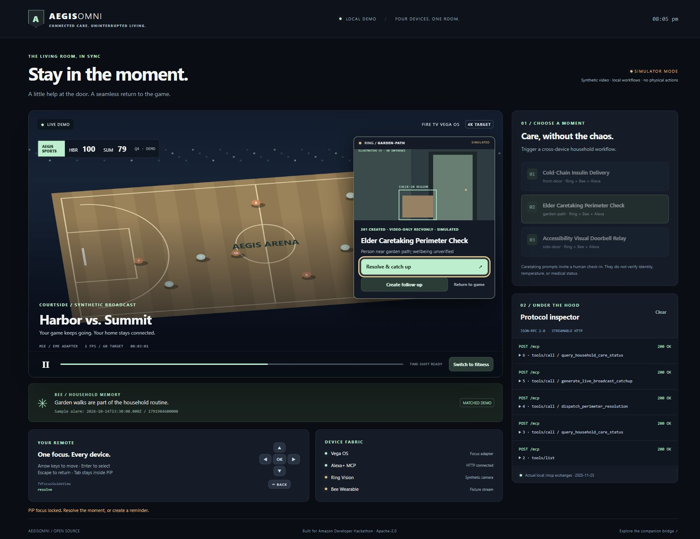

# AegisOmni

**Connected care. Uninterrupted living.** A 10-foot living room control center for Fire TV Vega OS, Alexa+ MCP, Ring camera workflows and Bee household memory.

AegisOmni demonstrates three non-security moments: a cold-chain pharmacy delivery check, an elderly relative's garden-path check-in, and an accessible visual doorbell relay. A camera overlay takes focus, household notes provide context, and dismissal restores the player with a summary of the exact missed broadcast interval.



## Run locally

Requirements: Node **24**, npm **11.6.2** and a modern browser. No cloud credentials or physical devices are needed for the default simulator.

```sh
npm install
npm test
npm run build
npm run start:mcp
```

Open **http://localhost:8080**. The server binds to loopback. On Windows with PowerShell script restrictions, use `npm.cmd` for these commands. For a lockfile-based clean install, use `npm ci` instead of `npm install`.

1. Choose a scenario on the right. Its camera and Bee household note appear in PiP.
2. Use arrow keys or the on-screen remote; Enter selects, Escape returns, and Tab stays inside the overlay.
3. Select **Create follow-up** to store a simulator reminder and inspect its ISO/epoch timestamps.
4. Select **Resolve & catch up** to return focus to the player. The summary includes only annotations in the missed media-time interval.
5. Expand inspector entries to see actual local JSON-RPC requests, Origin/Accept headers and 200/202 responses.

The sports/fitness canvas and camera scene are synthetic. FPS is measured browser rendering throughput against a 60 FPS target, not Vega device telemetry. “4K target” describes the intended native experience, not the canvas resolution. The default catch-up is an annotation-based generator, explicitly labeled **no model invoked**.

## Architecture

```text
                  FIRE TV / LIVING ROOM EXPERIENCE
         +------------------------------------------------+
         | Broadcast canvas / native player adapter       |
         | D-pad focus trap -> Ring PiP -> media bookmark  |
         | Restore player -> exact catch-up interval       |
         +-----------------------+------------------------+
                                 | actual local HTTP
                                 v
         +------------------------------------------------+
         | Express + MCP SDK / Streamable HTTP             |
         | Origin + Host checks | JSON-RPC | Zod contracts |
         +------------+--------------------+--------------+
                      |                    |
                      v                    v
         +----------------------+ +-----------------------+
         | Ring care registry   | | Bee context service   |
         | three camera events  | | facts / todos / SSE   |
         | SDP profile checks   | | ISO <-> epoch ms       |
         +----------------------+ +-----------------------+
                      \                    /
                       +------------------+
                       | Shared workflows |
                       | MCP and REST     |
                       +------------------+

      Separate optional cloud runtime (not invoked by the simulator)
         +------------------------------------------------+
         | Bedrock AgentCore -> Strands -> Nova Pro        |
         | Bee tools | supplied image assessment          |
         | annotation-grounded sports catch-up            |
         +------------------------------------------------+
```

See [ARCHITECTURE.md](ARCHITECTURE.md) for state transitions, trust boundaries and integration contracts.

## What is implemented and verified

| Track | Implemented here | Remaining production integration |
| --- | --- | --- |
| Vega / Fire TV | Native-component composition seam, focus/player ports, PiP state controller, schema-1 manifest; browser D-pad demo | SDK packaging, real TVFocusGuideView/FocusManager binding, device tests, licensed MSE/EME source |
| Alexa+ MCP | SDK tools over Streamable HTTP, JSON-RPC validation, Origin/Host/Accept checks, real protocol inspector | Authenticated Alexa+ host connection and deployment |
| Ring | Multi-camera care registry, video-only recvonly profile validation, simulated SDP response | OAuth linking, capability-driven live peer setup, track rendering and session cleanup |
| Bee | Simulator correlation, facts, todos and finite SSE snapshots; explicit injectable live proxy adapter | Authenticated proxy integration, stream reconnect/reconciliation and persistence |
| AWS | Four Strands tools, Nova Pro image-capable assessment, AgentCore entrypoint, isolated request context | Dependency/runtime validation, IAM, deployment, model access and cloud evaluation |

The server SDK currently advertises **2025-11-25**; it does not claim full 2026 protocol support. The [companion open-source bridge](https://github.com/Jeevang1-epic/react-native-vega-mcp-bridge) provides 2025/2026 envelope builders, ICE/session primitives, SSE parsing and playback bookmarks. It is a separate repository; this workspace contains no nested clone or dependency on an unpublished registry package.

The requested manifest targets the Vega 2.x runtime loader. Newer Vega 4.x SDK packaging requires migration. The TypeScript client exposes injectable native components and controller ports; it is not a completed `.vpkg` distribution.

## HTTP and MCP API

| Endpoint | Purpose |
| --- | --- |
| `GET /health` | Transport, supported revision, integration tracks and simulator provenance |
| `POST /mcp` | JSON-RPC initialization, tools/list, tools/call and notifications |
| `GET /api/scenarios` | Three scenarios and camera IDs |
| `POST /api/scenarios/trigger` | `{ "scenarioId": "cold_chain_delivery" }` (also `elder_care`, `accessibility_relay`) |
| `POST /api/ring/whep` | Validate `{ deviceId, sdpOffer, caretakingMode, iceGatheringState: "complete" }`; return simulated 201 |
| `POST /api/bee/correlate` | Search fixture household facts by `{ query, limit? }` |
| `GET /v1/facts` | Household fact fixtures |
| `GET /v1/todos`, `POST /v1/todos` | List/create session-local reminders |
| `GET /v1/stream?types=new-utterance,todo-created,update-conversation-summary` | Finite simulated SSE snapshot; reconnect explicitly |
| `POST /api/mcp/execute-action` | `{ name, arguments }` through the same service used by MCP tools |

Bee routes also have `/api/bee/facts`, `/api/bee/todos`, and `/api/bee/stream` aliases. `POST /v1/todos` requires `{ text, alarm_at }`; `alarm_at` is a timezone-aware ISO string or null. Read responses use epoch milliseconds or null, with canonical `alarmAtIso` on creation. Runtime memory is bounded and resets on restart.

MCP tools:

- `query_household_care_status`: read current events and notes.
- `create_caretaking_followup_todo`: create an explicitly requested reminder.
- `dispatch_perimeter_resolution`: acknowledge an existing `eventId`; actions are simulated, with no unlocking or physical actuation.
- `generate_live_broadcast_catchup`: accept `startSeconds`, `endSeconds` and `events: [{ at, description }]`; select events in **(start, end]** and return exact duration.

Example initialization (curl syntax for bash):

```sh
curl http://localhost:8080/mcp \
  -H 'Origin: http://localhost:8080' \
  -H 'Accept: application/json, text/event-stream' \
  -H 'Content-Type: application/json' \
  -H 'MCP-Protocol-Version: 2025-11-25' \
  -d '{"jsonrpc":"2.0","id":1,"method":"initialize","params":{"protocolVersion":"2025-11-25","capabilities":{},"clientInfo":{"name":"demo","version":"1.0"}}}'
```

The endpoint uses SDK stateless HTTP transport (no session IDs) for the supported 2025 revision. Valid notifications receive an empty 202. This is separate from the 2026 protocol's stateless envelope model. The demo is loopback-only and has no production authentication; deploy behind appropriate authentication and a configured host/origin policy before any external exposure.

## Optional Bee and AWS integration

`BeeContextService` defaults to fixtures. For integration code, construct it with `{ mode: "proxy", proxyUrl: "http://127.0.0.1:8787" }` and inject it into `new AegisServices(bee)` / `createExpressApp(services)`. A live proxy failure is an error; there is no silent success fallback. CLI startup deliberately remains simulator-only.

For the separate Python runtime:

```sh
python -m venv .venv
# Activate the virtual environment using your shell's standard command.
python -m pip install -r services/strands-agent-core/requirements.txt
python services/strands-agent-core/agent.py
```

AgentCore uses `BedrockModel(model_id="us.amazon.nova-pro-v1:0")` in `us-east-1` unless `AWS_DEFAULT_REGION` is set. Invoking its entrypoint calls Bedrock and requires authorized AWS credentials/model access. `AEGIS_MODE=simulator` is the default **tool** mode; it does not turn the agent model into an offline model. `AEGIS_MODE=live` enables proxy requests and optional image assessment; `BEE_PROXY_URL` must point to a proxy reachable from that runtime. A cloud container's loopback is not the developer's machine.

The tools are `query_bee_ambient_memory`, `create_bee_followup_todo`, `verify_ring_whep_perimeter_event`, and `synthesize_firetv_sports_catchup`. Live image assessment accepts a caller-supplied frame; it does not autonomously fetch Ring recordings. Deployment requires least-privilege IAM, secure account linking, user consent, retention controls and licensed media access. No deployment or billable model invocation is performed by `npm test`.

## Verification guide

```sh
npm test
npm run build
python -m unittest discover -s services/strands-agent-core/tests -v
python -m py_compile services/strands-agent-core/agent.py
```

- **37 Vitest tests:** 29 server integration cases plus eight Vega/Bee controller contracts.
- **Eight Python contract tests:** dependency stubs verify tool logic and request isolation without cloud SDK installation or credentials.
- **Build:** strict TypeScript checks both server and Vega controller workspaces.
- **Browser QA:** actual MCP initialization/tool calls, notification 202, delivery reminder creation, PiP D-pad navigation and Escape/catch-up flow.

Test fixtures demonstrate behavior, not native device certification, medical detection or real delivery identity verification. Annotated catch-up never invents a play when the supplied interval has no events. The simulator's model and device status labels remain explicit.

## Appstore roadmap and commercial model

This is a proposed product roadmap, not an approved listing or a revenue forecast.

1. **Integration pilot:** test supported Vega hardware and Ring cameras, link Bee accounts, instrument focus/replay behavior, and validate accessibility with consenting households.
2. **Fire TV Appstore candidate:** package the native UI, replace synthetic media with licensed content, complete remote navigation/performance checks and review store requirements. Offer the living-room experience as the primary app surface.
3. **Ring Appstore candidate:** build authorized account linking, capability-aware camera sessions, clear consent and minimal retention. Focus on delivery assistance, relative check-ins and accessible notifications, without security or diagnostic claims.
4. **Commercial options:** retain the Apache-2.0 bridge and developer simulator; evaluate an optional hosted coordination subscription for multi-device households and partner integration/support plans. Model inference, video transport and support costs must be measured before setting prices.
5. **Launch gates:** device QA, accessibility testing, account revocation, failure-mode testing, privacy review, content rights and applicable store approvals. No automatic door unlocking or emergency-response promise.

## Repository map

```text
apps/vega-firetv-client/       manifest + native composition/controller ports
services/alexa-mcp-server/    MCP/REST workflows, simulator UI and Vitest tests
services/strands-agent-core/  optional Python runtime and offline contract tests
docs/friction-logs/           five evidence-labeled issues and product feedback
```

See [friction logs and product feedback](docs/friction-logs/FRICTION_LOG_AND_FEEDBACK.md) for reproduction steps and prioritized requests. Reported ADBT/TLS symptoms are marked unverified rather than presented as observed vendor defects.

## License

Apache-2.0. See [LICENSE](LICENSE). `.nvmrc` retains Node 24.

## Vercel deployment

Import this repository with the repository root as **Root Directory**, framework preset **Other**, and Node 24. The checked-in `vercel.json` runs `npm run build`, publishes the simulator assets, and rewrites application routes to `api/index.js`. That entrypoint exports the compiled Express application without opening a port. Function bundling explicitly includes compiled backend files and public assets, so Express can also serve `/`, `/styles.css`, and `/simulator.js`. `/mcp`, `/health`, `/api/*`, and `/v1/*` use the same function.

Origins are parsed as URLs: the existing explicit allowlist, same-host origins, and HTTPS subdomains of `.vercel.app` are accepted. Forwarded host matching is enabled only when Vercel sets `VERCEL=1`. Malformed origins and suffix lookalikes are rejected. Allowing all Vercel tenant origins is intentional per this demo policy; it is not authentication. Restrict that policy and add authentication before connecting private household data.

**State limitation:** care events and reminders remain in-memory demo data. Warm function invocations may reuse them, but cold starts and parallel instances do not share them. A trigger followed by a resolution on another instance can report an unknown event. Use a shared durable store before relying on multi-request workflow continuity in production. This configuration makes the UI and endpoints deployable; it does not make the demo state durable or deploy the separate Python AgentCore runtime.

After deployment, check `/`, `/styles.css`, `/simulator.js`, `/health`, `/api/scenarios`, and an MCP initialize/tools/list exchange. Hosted deployment and cross-instance persistence are separate from the local verification suite. Configuration follows [Vercel function and rewrite settings](https://vercel.com/docs/project-configuration/vercel-json).
